# Door Control for 2N

Web app to open doors, gates and locks on 2N IP intercoms and access units from a phone.
Works on Android and iPhone (add it to the home screen and it opens like a normal app).

One install per client. Each install has its own logo, name, color, users and doors.

<p>
  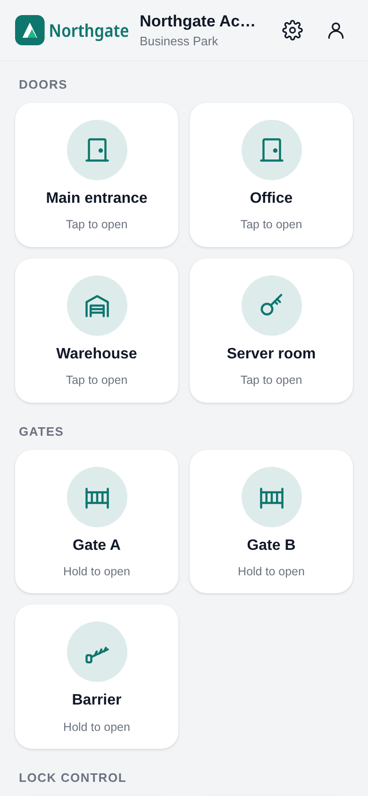
  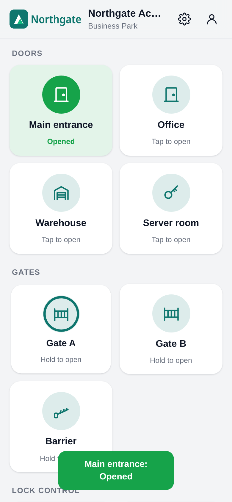
  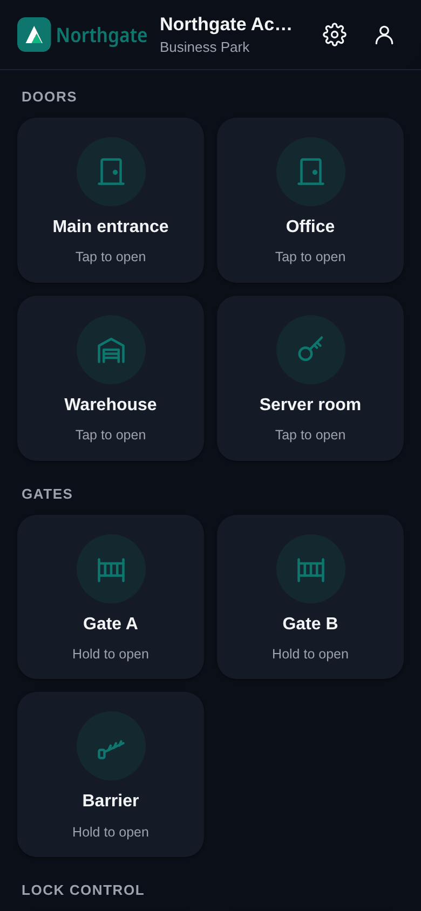
</p>

## Install

On the 2N Access Commander VM (or any Debian/Ubuntu x86_64 machine), as root:

```
curl -fsSL https://raw.githubusercontent.com/MrRitchietos/doorcontrol-2n/main/install.sh | bash
```

At the end it prints the address. Open it and the first screen asks you to make the admin account
(only on the very first start, it never shows again once there is a user).

Run the same line again to update. Users, doors, settings and the certificate stay.

**Auto update:** every server checks GitHub every hour and installs what is new. When a new
version does not start, the previous one is put back by itself. In the app, Settings > Look >
Updates shows the version and the last check, and has an on/off switch and an "update now" button.
Install with `--no-auto-update` to switch it off from the start.

The app runs on port **8080** (http) and **8443** (https, once there is a certificate), so Access
Commander keeps 80 and 443. It brings its own Python in `/opt/doorcontrol`, data lives in
`/var/lib/doorcontrol`. Nothing is installed with apt. When ufw is on, both ports are opened in ufw.

### Options

Add them after `bash -s --`, for example:

```
curl -fsSL https://raw.githubusercontent.com/MrRitchietos/doorcontrol-2n/main/install.sh | bash -s -- --cert /root/wildcard.pfx --password 'secret' --domain door.company.be
```

| Option | |
|---|---|
| `--port 8080` | http port |
| `--https-port 8443` | https port |
| `--cert FILE` | certificate: a `.pfx` / `.p12`, or a `.crt` together with `--key FILE` |
| `--password PW` | password of the `.pfx` or the key |
| `--domain NAME` | the name phones use, for example `door.company.be` |
| `--self-signed` | self-signed certificate (Android will not install the app with it) |
| `--http` | remove the certificate, plain http only |
| `--version v1.0.0` | install a tagged version |
| `--no-auto-update` | do not check GitHub every hour |
| `--uninstall` | remove, keep the data |
| `--purge` | remove everything, data too |

## Https and phones

* **iPhone**: Safari, Share, Add to Home Screen. Works over plain http too.
* **Android**: Chrome only installs it as a real app (own icon, no address bar) over https with a
  trusted certificate. Over http you only get a shortcut that opens in a Chrome tab.

So for Android:

1. Make a DNS record, for example `door.company.be`, to the IP of the VM (internal DNS is fine).
2. In the app go to **Settings > HTTPS**, fill in the domain and upload the certificate
   (`.pfx` with its password, or the `.crt` and `.key`). A wildcard like `*.company.be` works.
   When the intermediate certificate is missing, the app fetches it by itself.
3. https starts right away on port 8443, no restart needed. Open `https://door.company.be:8443`
   on the phone, then menu, **Install app**.
4. Optional: switch on **Always use https** so the old http address sends people to https.

The certificate page shows who it is for, until when it is valid, and warns when it is
self-signed, for another domain, or expires within 30 days.

<p>
  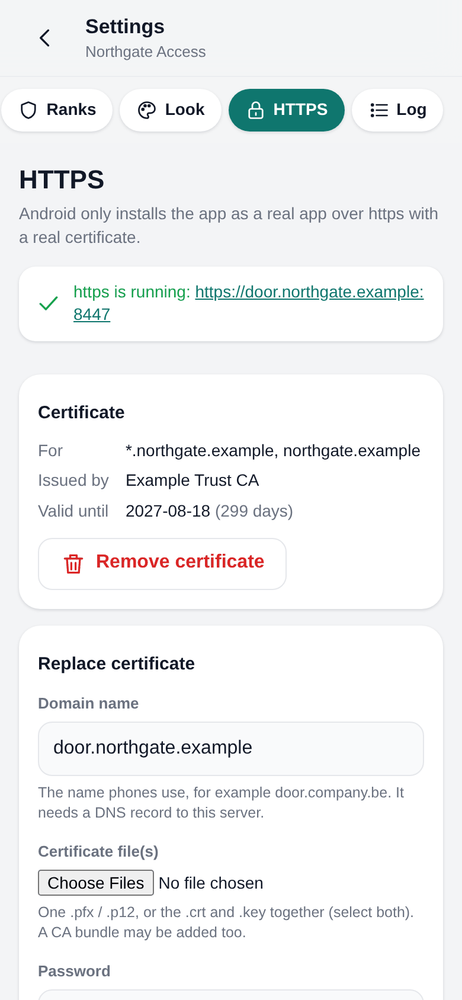
</p>

For access from outside the site, put it behind the firewall's reverse proxy (for example pfSense
HAProxy) and point it to the VM on port 8080 or 8443.

## Setting up a client

1. Log in as admin, tap the gear.
2. **Look**: upload the client logo, set the name and color. The phone icon is made from the logo.
3. **Intercoms**: add every 2N with its IP. Tap Test to see the model and firmware.
4. **Doors**: add a button per door and pick what it does on which intercom.
5. **Ranks**: make groups like "Staff" or "Night shift" with the doors they may open and when.
6. **Users**: add people and give them a rank.

<p>
  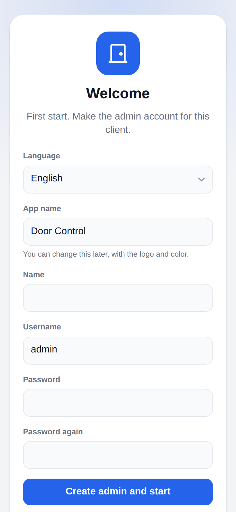
  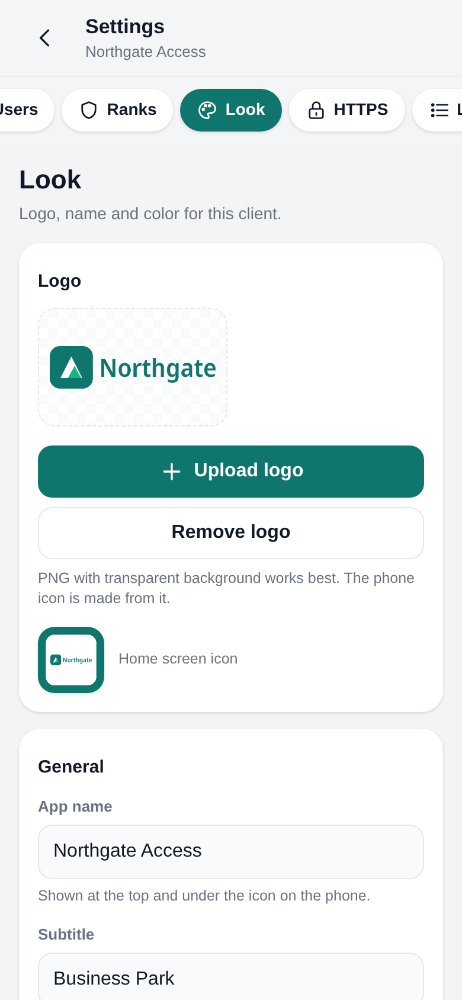
  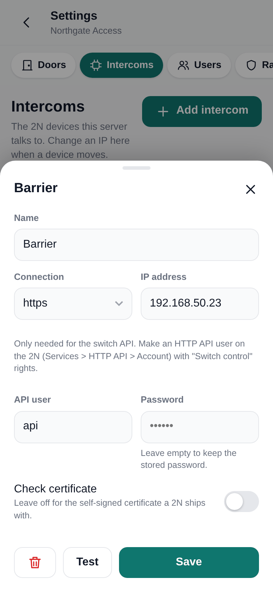
  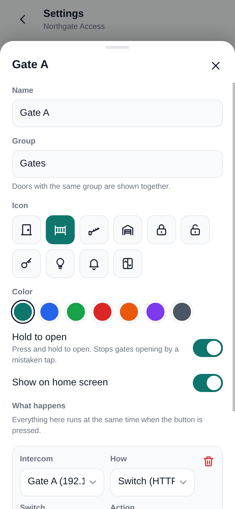
</p>

### How a door is opened

A door button can do one or more actions, all at the same time:

* **Switch (HTTP API)**: `/api/switch/ctrl?switch=1&action=trigger`. Needs an HTTP API user on the
  2N (Services > HTTP API > Account) with switch control rights. Use https, that is the 2N default.
* **Automation HTTP trigger**: `/enu/trigger/<name>`, for example `open`, `hold`, `unhold`.
  Needs an Event.HttpTrigger in the 2N Automation.
* **Other URL path**: any other GET on the device.

"Hold to open" makes people keep their finger on the button for a moment, so a gate does not open
by a tap in a pocket. When a 2N only answers on https, the app says so instead of reporting a
false success.

### Ranks, users and log

* Rank 1 is the admin and can do everything. It cannot be removed.
* Other ranks get any mix of: manage users, manage doors and intercoms, change look and settings,
  see the log. Plus which doors, which days and which hours.
* Someone who manages users can only add or change users with a lower rank than their own.
* Disabling a user, changing their rank or password logs them out everywhere.
* The log shows who opened what, when and from where, also failed tries.

<p>
  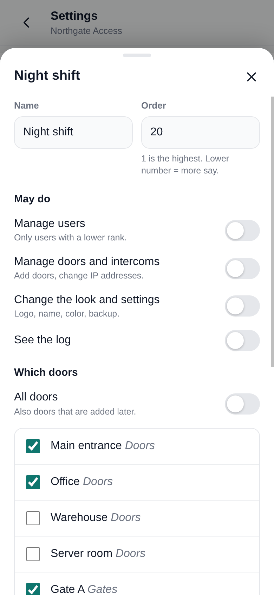
  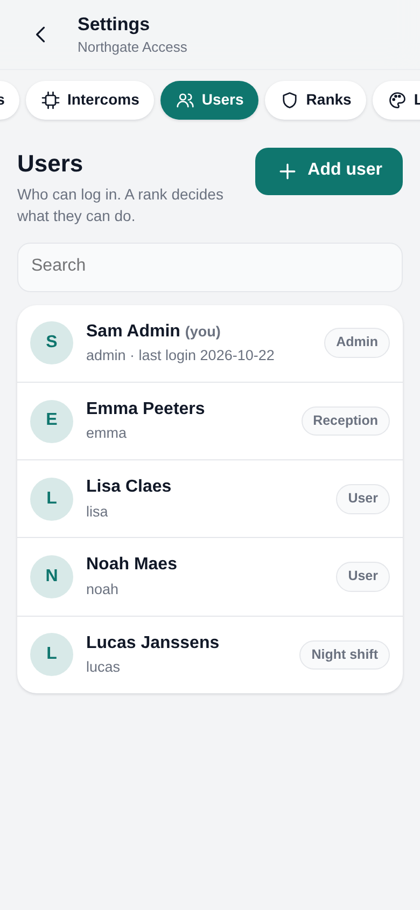
  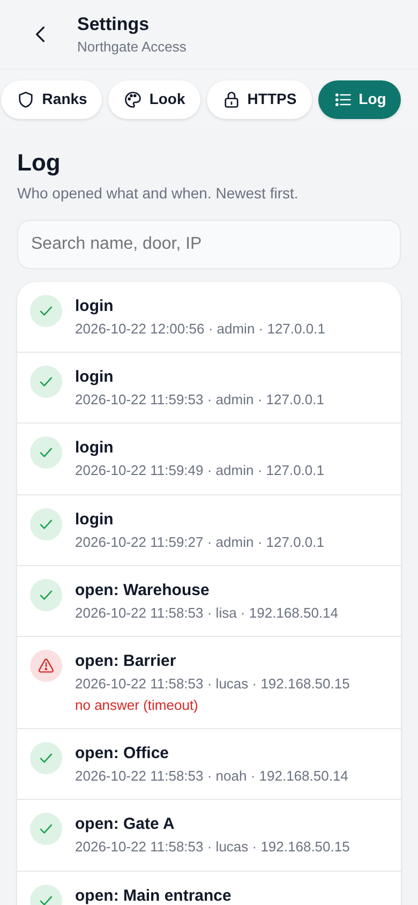
</p>

It works on a desktop browser too:

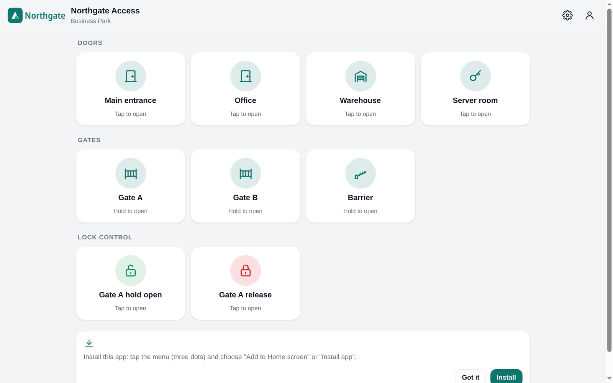

## Handy commands on the VM

```
doorcontrol reset-admin                      # new admin password when locked out
doorcontrol import-cert FILE --password PW   # certificate from the command line, then: systemctl restart doorcontrol
doorcontrol https-off                        # remove the certificate and the https redirect
doorcontrol restore backup.db                # put back a backup from Look > Backup, then: systemctl restart doorcontrol
journalctl -u doorcontrol -f                 # logs
```

## Development

```
python3 -m venv .venv
.venv/bin/pip install -r requirements-dev.txt
.venv/bin/python -m doorcontrol --data data serve --port 8080
.venv/bin/python -m pytest
```

The first start asks for the admin account. Tests use a fake 2N on localhost, no real devices are touched.
